# Introduction

### Basic use

First we load the peptools package. Note that we do not need to install
it every time we use R, but we do need to load the package.

``` r

library(peptools)
```

The package includes a `pepstations` data object that includes metadata
for each station, including lat/lon and bay segment. We can use the sf
and dplyr package to make this a spatial data object, then plot it with
leaflet (you may need to install these packages if you don’t have them).
Note that the peptools package has built-in mapping functions, this
example just shows how to create a map from scratch.

``` r

library(sf)
library(dplyr)
library(leaflet)

locs <- pepstations %>% 
  sf::st_as_sf(coords = c('Longitude', 'Latitude'), crs = 4326) %>% 
  dplyr::mutate(bay_segment = as.character(bay_segment))

pal <- colorFactor('Set1', domain = locs$bay_segment)

leaflet(locs) %>% 
  addProviderTiles('Esri.WorldGrayCanvas', group = 'World Gray') %>% 
  addProviderTiles('Esri.WorldImagery', group = 'World Imagery') %>% 
  addProviderTiles('Esri.WorldTopoMap', group = 'World Topo Map') %>% 
  addLayersControl(baseGroups = c('World Gray', 'World Imagery', 'World Topo Map')) %>% 
  addCircleMarkers(radius = 6, color = 'black', weight = 1, fillColor = ~pal(bay_segment), 
                   fillOpacity = 0.8, label = ~paste('Bay station', BayStation)) %>% 
  addLegend('bottomright', pal = pal, values = ~bay_segment, title = 'Bay segment')
```

The `pepseg` data object also included with the package shows the
polygons for the bay segments.

``` r

leaflet(sf::st_transform(pepseg, 4326)) %>% 
  addProviderTiles('Esri.WorldGrayCanvas', group = 'World Gray') %>% 
  addProviderTiles('Esri.WorldImagery', group = 'World Imagery') %>% 
  addProviderTiles('Esri.WorldTopoMap', group = 'World Topo Map') %>% 
  addLayersControl(baseGroups = c('World Gray', 'World Imagery', 'World Topo Map')) %>% 
  addPolygons(color = 'grey', weight = 1, fillOpacity = 0.4, label = ~paste('Bay segment', bay_segment))
```

The water quality data can be imported using the
[`read_pepwq()`](https://tbep-tech.github.io/peptools/reference/read_pepwq.md)
function. A compressed folder that includes the data can be downloaded
from
[here](https://gis.suffolkcountyny.gov/portal/home/item.html?id=5d4b53ec44204219a8da685f1859e096).
After the data are downloaded and extracted, the Excel file with the raw
data is named “Peconics SCDHS WQ data - 1976 - 2nd Q 2026DRAFT - updated
07212026.xlsx”, or something similar depending on when the data were
downloaded. The location of this file on your computer is passed to the
import function. Below, a local file renamed as “currentdata.xlsx” that
contains the water quality data is imported. The data include a partial
year for 2026, so only data through 2025 are retained for the examples
in this vignette.

``` r

dat <- read_pepwq('../inst/extdata/currentdata.xlsx') %>%
  filter(yr <= 2025)
head(dat)
#> # A tibble: 6 × 11
#>   Date       BayStation name  value status    yr    mo StationName   bay_segment
#>   <date>     <chr>      <chr> <dbl> <chr>  <dbl> <dbl> <chr>         <fct>      
#> 1 1990-01-31 60113      chla    4.8 ""      1990     1 Little Pecon… 2          
#> 2 1990-01-31 60113      sd      8   ""      1990     1 Little Pecon… 2          
#> 3 1990-01-31 60114      chla    2.8 ""      1990     1 Paradise Poi… 2          
#> 4 1990-01-31 60114      sd     12   ""      1990     1 Paradise Poi… 2          
#> 5 1990-01-31 60115      chla    8.5 ""      1990     1 Orient Harbor 3          
#> 6 1990-01-31 60115      sd      7   ""      1990     1 Orient Harbor 3          
#> # ℹ 2 more variables: Longitude <dbl>, Latitude <dbl>
```

The raw data includes multiple fields, but only the chlorophyll, secchi,
and total nitrogen data are retained for reporting. The data are in long
format with the `name` column showing which observation (chlorophyll,
secchi, or total nitrogen) the row `value` shows and the `status`
showing if the observation was above or below detection (indicated as
`>` or `<`, secchi only). Each station is also grouped by major bay
segment, defined as 1a, 1b, 2, 3.

A quick view of the number of observations and length of record at each
station shows that effort was not continuous.

``` r

library(ggplot2)

toplo <- dat %>% 
  select(bay_segment, BayStation, yr, name, value) %>% 
  group_by(bay_segment, BayStation, yr, name) %>% 
  summarise(`Obs. (n)` = n())

p <- ggplot(toplo, aes(x = yr, y = BayStation, fill = `Obs. (n)`)) + 
  geom_tile()+ #colour = 'lightgrey') + 
  facet_grid(bay_segment ~ name, scales = 'free_y', space = 'free_y') + 
  theme_bw() + 
  theme(
    panel.grid.major = element_blank(), 
    panel.grid.minor= element_blank(),
    strip.background = element_blank(), 
    axis.title.x = element_blank(), 
    legend.position = 'top', 
    axis.text.y = element_text(size = 7)
  ) + 
  scale_fill_viridis_c()

p
```

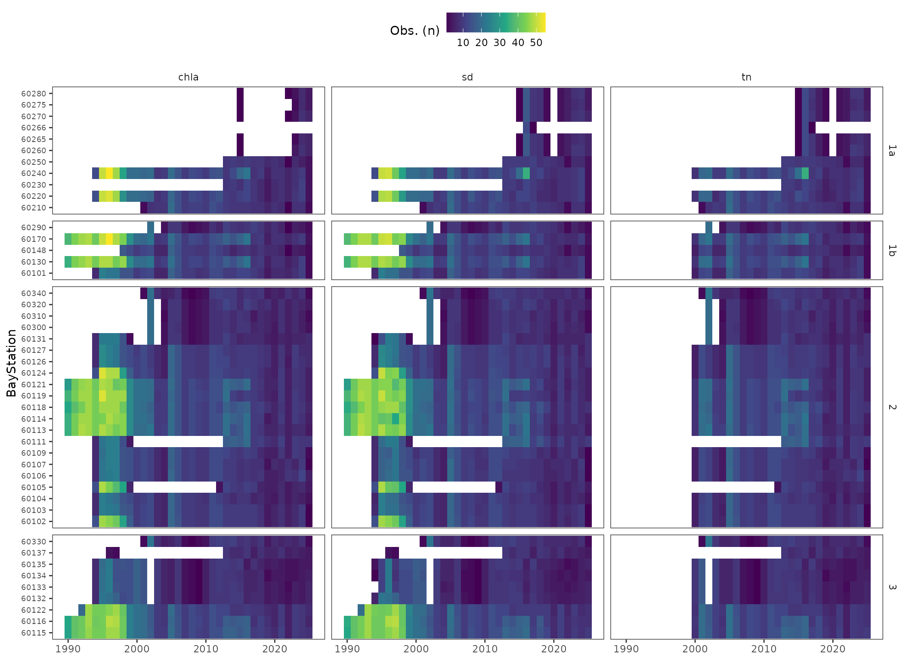

The function `anlz_pepdat()` summarizes the station data by bay segment.
The function returns annual medians and monthly medians by year for
chlorophyll, secchi depth, and total nitrogen. The chlorophyll and
secchi summaries are then used to determine if bay segment targets for
water quality are met using the `anlz_attain()` and
[`anlz_attainpep()`](https://tbep-tech.github.io/peptools/reference/anlz_attainpep.md)
functions.

Below shows how to use `anlz_pepdat()` to summarize the data by bay
segment to estimate annual and monthly medians for chlorophyll, secchi
depth, and total nitrogen. The output is a two-element list for the
annual (ann) and monthly (mos) medians by segment.

``` r

medpep <- anlz_medpep(dat)
medpep
#> $ann
#> # A tibble: 1,296 × 5
#>    bay_segment    yr   val est    var  
#>    <fct>       <dbl> <dbl> <chr>  <chr>
#>  1 1a           2025  3.32 lwr.ci chla 
#>  2 1a           2025  7.12 medv   chla 
#>  3 1a           2025 16.8  upr.ci chla 
#>  4 1a           2024  6.29 lwr.ci chla 
#>  5 1a           2024  8.39 medv   chla 
#>  6 1a           2024 11.9  upr.ci chla 
#>  7 1a           2023  6.6  lwr.ci chla 
#>  8 1a           2023  8.53 medv   chla 
#>  9 1a           2023 10.8  upr.ci chla 
#> 10 1a           2022  4.16 lwr.ci chla 
#> # ℹ 1,286 more rows
#> 
#> $mos
#> # A tibble: 5,184 × 6
#>    bay_segment    yr    mo   val est   var  
#>    <fct>       <dbl> <dbl> <dbl> <chr> <chr>
#>  1 1a           2025    12 NA    medv  chla 
#>  2 1a           2025    11 NA    medv  chla 
#>  3 1a           2025    10  4.88 medv  chla 
#>  4 1a           2025     9 NA    medv  chla 
#>  5 1a           2025     8 34.2  medv  chla 
#>  6 1a           2025     7 19.8  medv  chla 
#>  7 1a           2025     6 16.8  medv  chla 
#>  8 1a           2025     5  6.1  medv  chla 
#>  9 1a           2025     4  1.18 medv  chla 
#> 10 1a           2025     3 NA    medv  chla 
#> # ℹ 5,174 more rows
```

This output can then be further analyzed with
[`anlz_attainpep()`](https://tbep-tech.github.io/peptools/reference/anlz_attainpep.md)
to determine if the bay segment outcomes are met in each year for
chlorophyll and secchi depth. The results are used by the plotting
functions described below. In short, the `chl_sd` column indicates the
categorical outcome for chlorophyll and secchi for each segment. The
outcomes are integer values from zero to three. The relative exceedances
of water quality thresholds for each segment, both in duration and
magnitude, are indicated by higher integer values.

``` r

anlz_attainpep(medpep)
#> # A tibble: 144 × 4
#>    bay_segment    yr chla_sd outcome
#>    <fct>       <dbl> <chr>   <chr>  
#>  1 1a           2025 2_3     red    
#>  2 1a           2024 3_3     red    
#>  3 1a           2023 3_3     red    
#>  4 1a           2022 2_2     red    
#>  5 1a           2021 3_2     red    
#>  6 1a           2020 2_NA    NA     
#>  7 1a           2019 2_3     red    
#>  8 1a           2018 2_3     red    
#>  9 1a           2017 3_3     red    
#> 10 1a           2016 3_3     red    
#> # ℹ 134 more rows
```

### Plotting

The plotting functions are used to view station data, long-term trends
for each bay segment, and annual results for the overall water quality
assessment.

The
[`show_sitemappep()`](https://tbep-tech.github.io/peptools/reference/show_sitemappep.md)
function produces an interactive map of medians of water quality
conditions at each station. Medians can be shown for chlorophyll, secchi
depth, or total nitrogen and for all stations or only stations from
selected bay segments. Each point on the map shows the median for the
parameter, with the size and color of the point in proportion to the
other median values shown on the map. The color scale for the median
shows higher concentrations of chlorophyll/total nitrogen or shallower
secchi depths in red and lower concentrations of chlorophyll/total
nitrogen or deeper secchi depths in blue. Hovering the mouse pointer
over a site location will indicate the site name and the median value.
Clicking on a station point will reveal the underlying plot data.

Here, the 2025 chlorophyll medians are shown for stations in all bay
segments.

``` r

show_sitemappep(dat, yrsel = 2025)
```

Medians for a given month can also be shown.

``` r

show_sitemappep(dat, mosel = 7)
```

A different year, parameter, and bay segment can also be chosen. Note
that the size and color ramps are reversed for secchi depth, such that
smaller and bluer points indicate larger secchi values.

``` r

show_sitemappep(dat, yrsel = 2010, param = 'sd', bay_segment = c('2', '3'))
```

By default, the color and size scaling in
[`show_sitemappep()`](https://tbep-tech.github.io/peptools/reference/show_sitemappep.md)
is relative to only the points on the map. You can view scaling relative
to all values in the dataset (across time and space) to get a sense of
how the values for the selected year compare to the rest of the record.
This can be done by changing the `relative` argument to `TRUE`.

``` r

show_sitemappep(dat, yrsel = 2025, relative = T)
```

The scaling is also sensitive to outliers. The default is to use the
maximum scaling as the 99th percentile value observed in the entire
dataset for the chosen parameter. Otherwise, results that are visually
difficult to interpret will be returned if the absolute maximum value is
used to set the scale. If, however, you want to see scaling relative to
a smaller quantile, you can change the value with the `maxrel` argument.
The size and color ramps will be scaled to the defined upper quantile
value. The actual observed value at a point will always be visible on
mouseover.

``` r

show_sitemappep(dat, yrsel = 2025, relative = T, maxrel = 0.8)
```

The
[`show_thrpep()`](https://tbep-tech.github.io/peptools/reference/show_thrpep.md)
function provides a more descriptive assessment of annual trends for a
chosen bay segment relative to thresholds. In this plot, we show the
annual medians and non-parametric confidence internals (95%) across
stations for a segment. The red line shows annual trends and the
horizontal blue line indicates the threshold for chlorophyll-a.

``` r

show_thrpep(dat, bay_segment = "1a", param = "chla")
```

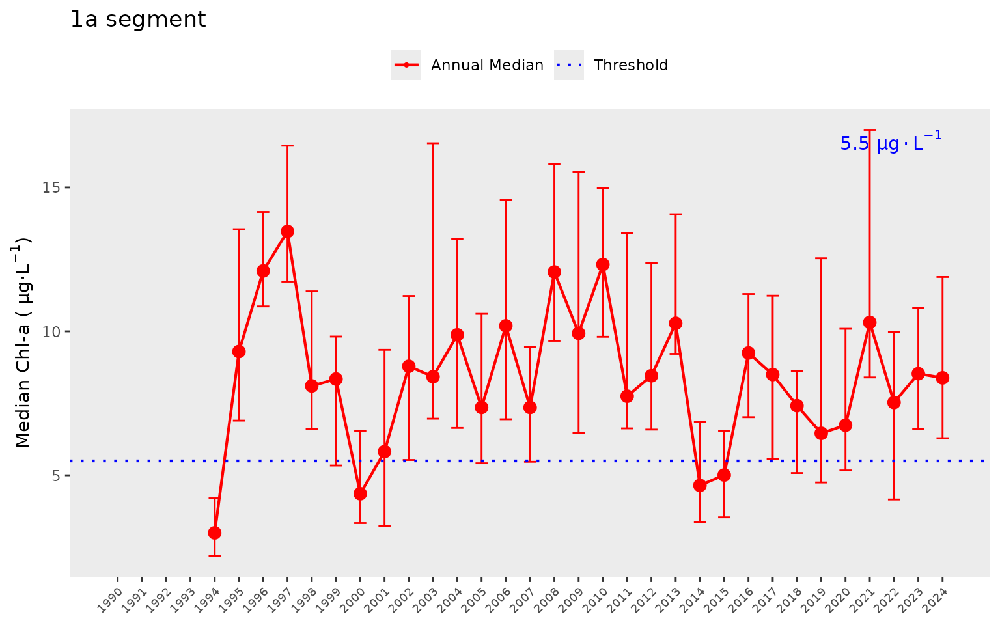

We can show the same plot but for secchi depth by changing the
`param = "chla"` to `param = "sd"`. Note the change in the horizontal
reference lines for the secchi depth target. Secchi trends must also be
interpreted inversely to chlorophyll, such that lower values generally
indicate less desirable water quality.

``` r

show_thrpep(dat, bay_segment = "1a", param = "sd")
```

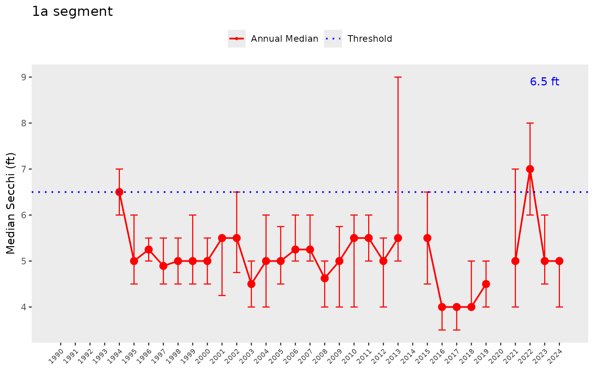

Total nitrogen can also be plotted.

``` r

show_thrpep(dat, bay_segment = "1a", param = "tn")
```

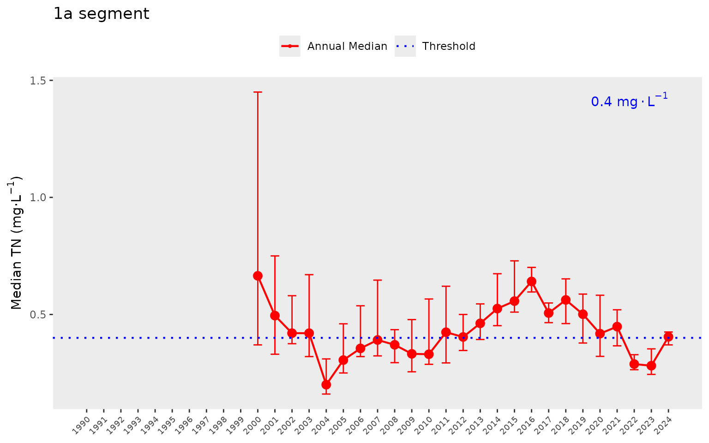

The year range to plot can also be specified using the `yrrng` argument,
where the default is the full range of years in the data.

``` r

show_thrpep(dat, bay_segment = "1a", param = "chla", yrrng = c(2000, 2025))
```

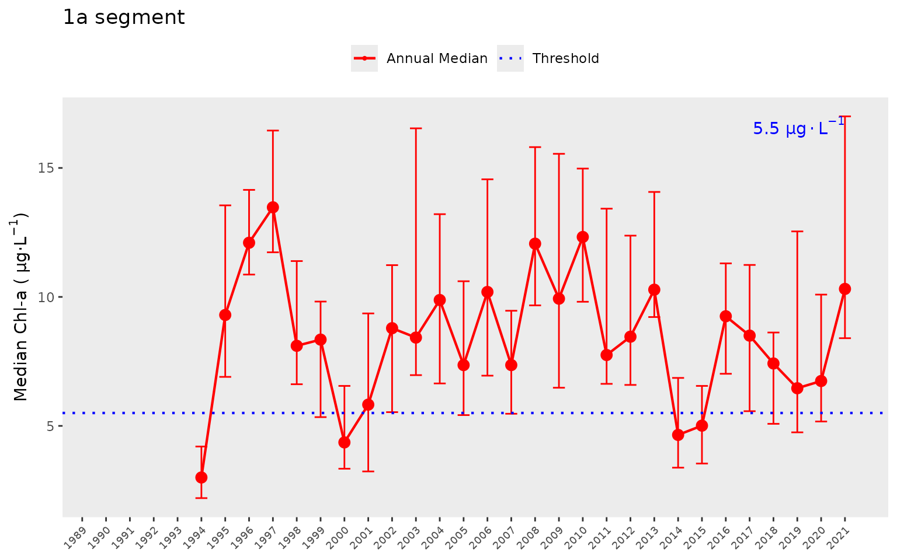

The
[`show_allthrpep()`](https://tbep-tech.github.io/peptools/reference/show_allthrpep.md)
function is a slight modification of
[`show_thrpep()`](https://tbep-tech.github.io/peptools/reference/show_thrpep.md)
that shows annual median results for all bay segments combined. It
accepts similar arguments as
[`show_thrpep()`](https://tbep-tech.github.io/peptools/reference/show_thrpep.md).
Note that threshold values for chlorophyll-a and Secchi depth can also
be shown because the thresholds do not vary between segments. A
modification fo the function will be required if these thresholds are
modified for specific bay segments.

``` r

show_allthrpep(dat, param = "chla")
```

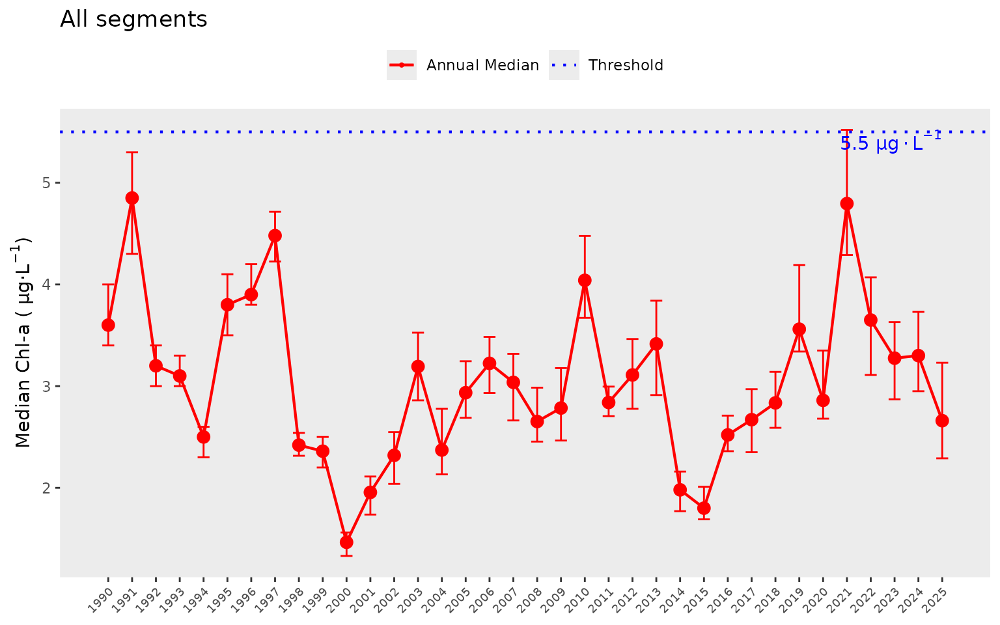

The
[`show_thrpep()`](https://tbep-tech.github.io/peptools/reference/show_thrpep.md)
function uses results from the
[`anlz_medpep()`](https://tbep-tech.github.io/peptools/reference/anlz_medpep.md)
function. For example, you can retrieve the values from the above plot
as follows:

``` r

dat %>% 
  anlz_medpep %>% 
  .[['ann']] %>% 
  filter(bay_segment == '1a') %>% 
  filter(var == 'chla') %>% 
  filter(yr >= 1990 & yr <= 2025)
#> # A tibble: 108 × 5
#>    bay_segment    yr   val est    var  
#>    <fct>       <dbl> <dbl> <chr>  <chr>
#>  1 1a           2025  3.32 lwr.ci chla 
#>  2 1a           2025  7.12 medv   chla 
#>  3 1a           2025 16.8  upr.ci chla 
#>  4 1a           2024  6.29 lwr.ci chla 
#>  5 1a           2024  8.39 medv   chla 
#>  6 1a           2024 11.9  upr.ci chla 
#>  7 1a           2023  6.6  lwr.ci chla 
#>  8 1a           2023  8.53 medv   chla 
#>  9 1a           2023 10.8  upr.ci chla 
#> 10 1a           2022  4.16 lwr.ci chla 
#> # ℹ 98 more rows
```

Similarly, the
[`show_boxpep()`](https://tbep-tech.github.io/peptools/reference/show_boxpep.md)
function provides an assessment of seasonal changes in chlorophyll,
secchi depth, or total nitrogen values by bay segment. The most recent
year is highlighted in red by default. This allows a simple evaluation
of how the most recent year compared to historical averages. The
threshold value is shown in blue text and as the dotted line (not shown
for total nitrogen). This is the same dotted line shown in
[`show_thrpep()`](https://tbep-tech.github.io/peptools/reference/show_thrpep.md).

``` r

show_boxpep(dat, param = 'chla', bay_segment = "1a")
```

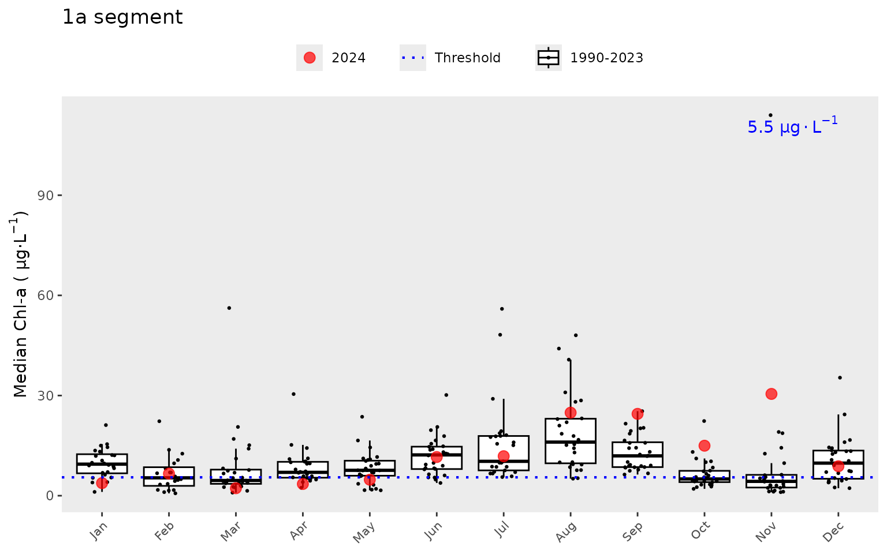

``` r

show_boxpep(dat, param = 'sd', bay_segment = "3")
```

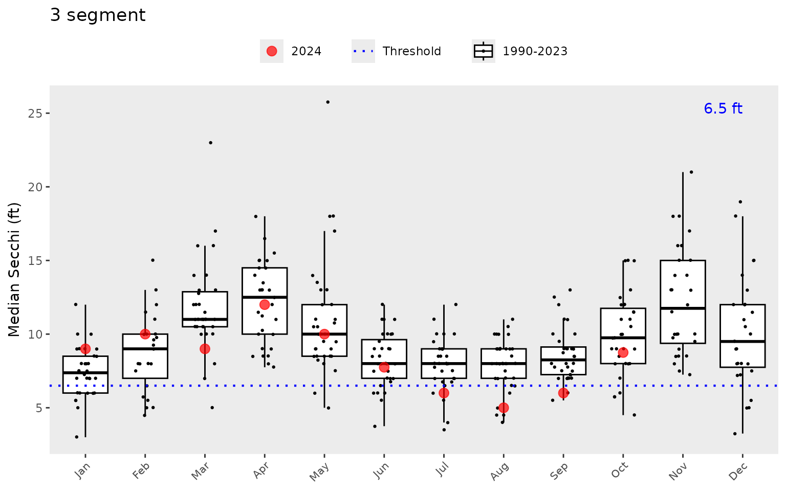

A different subset of years and selected year of interest can also be
viewed by changing the `yrrng` and `yrsel` arguments. Here we show 2000
compared to monthly averages for the last ten years.

``` r

show_boxpep(dat, param = 'chla', bay_segment = "1a", yrrng = c(2016, 2025), yrsel = 2000)
```

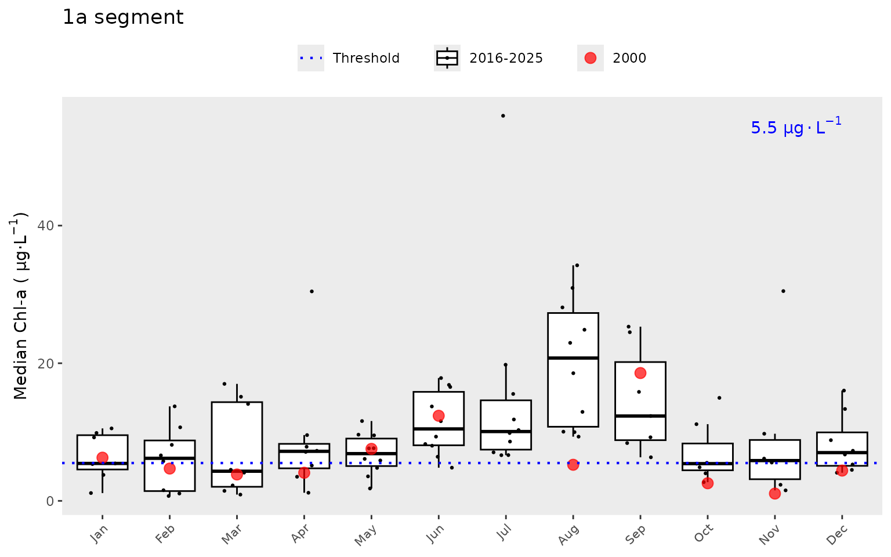

The
[`show_thrpep()`](https://tbep-tech.github.io/peptools/reference/show_thrpep.md)
function is useful to understand annual variation in chlorophyll,
secchi, or total nitrogen in each bay segment. For chlorophyll and
secchi, the information from these plots can provide an understanding of
how the annual reporting outcomes are determined. An outcome integer
from zero to three is assigned to each bay segment for each annual
estimate of chlorophyll and secchi depth. These outcomes are based on
both the exceedance of the annual estimate above the threshold (blue
lines in
[`show_thrpep()`](https://tbep-tech.github.io/peptools/reference/show_thrpep.md))
and duration of the exceedance for the years prior. The following
graphic describes this logic \[1\].


Outcomes for annual estimates of water quality are assigned an integer
value from zero to three depending on both magnitude and duration of the
exceedence.

For the Peconic Estuary, light attenuation is replaced with Secchi
depth. The outcomes above are assigned for both chlorophyll and secchi
depth. The duration criteria are determined based on whether the
exceedance was observed for years prior to the current year. The
exceedance criteria for chlorophyll and light-attenuation are currently
the same for each segment. The peptools package contains a `peptargets`
data file that is a reference for determining annual outcomes. This file
is loaded automatically with the package and can be viewed from the
command line.

``` r

peptargets
#> # A tibble: 4 × 5
#>   bay_segment name  sd_thresh chla_thresh tn_thresh
#>   <fct>       <fct>     <dbl>       <dbl>     <dbl>
#> 1 1a          1a          6.5         5.5       0.4
#> 2 1b          1b          6.5         5.5       0.4
#> 3 2           2           6.5         5.5       0.4
#> 4 3           3           6.5         5.5       0.4
```

The final plotting function is
[`show_matrixpep()`](https://tbep-tech.github.io/peptools/reference/show_matrixpep.md),
which creates an annual reporting matrix that reflects the combined
outcomes for chlorophyll and secchi depth. Tracking the attainment
outcomes provides the framework from which bay management actions can be
developed and initiated. For each year and segment, a color-coded
management action is assigned:

**Stay the Course**: Continue planned projects. Report data via annual
progress reports and Baywide Environmental Monitoring Report.

**Caution**: Review monitoring data and nitrogen loading estimates.
Begin/continue TAC and Management Board development of specific
management recommendations.

**On Alert**: Finalize development and implement appropriate management
actions to get back on track.

The management category or action is based on the combination of
outcomes for chlorophyll and secchi depth \[1\].


Management action categories assigned to each bay segment and year based
on chlorophyll and Secchi depth outcomes.

The results can be viewed with
[`show_matrixpep()`](https://tbep-tech.github.io/peptools/reference/show_matrixpep.md).

``` r

show_matrixpep(dat)
```

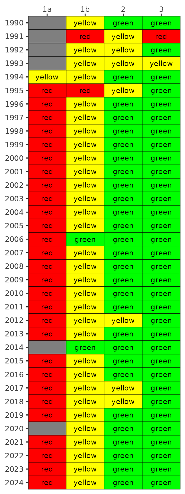

The matrix is also a `ggplot` object and its layout can be changed using
`ggplot` elements. Note the use of `txtsz = NULL` to remove the color
labels.

``` r

show_matrixpep(dat, txtsz = NULL) +
  scale_y_continuous(expand = c(0,0), breaks = c(1990:2025)) +
  coord_flip() +
  theme(axis.text.x = element_text(angle = 45, hjust = 1, size = 7))
```

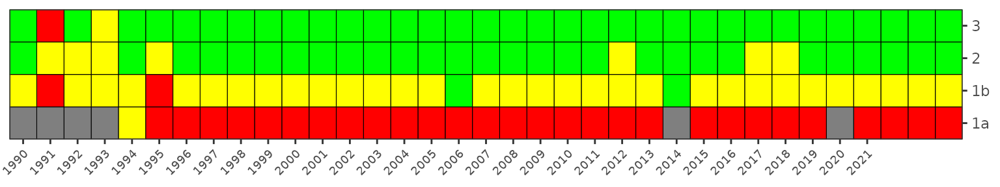

If preferred, the matrix can also be returned in an HTML table that can
be sorted and scrolled.

``` r

show_matrixpep(dat, asreact = TRUE)
```

Use a sufficiently large number to view the entire matrix.

``` r

show_matrixpep(dat, asreact = TRUE, nrows = 200)
```

Bay segment exceedances can also be viewed in a matrix using
[`show_wqmatrixpep()`](https://tbep-tech.github.io/peptools/reference/show_wqmatrixpep.md).
The not met/met outcome categories indicate if the median was
above/below the threshold. However, the small/large exceedances used for
the overall report card depend on degree of overlap of the confidence
intervals with the threshold. The matrix outcome below is a
simplification that shows a binary outcome (not met/met) for location of
the median relative to the threshold.

``` r

show_wqmatrixpep(dat)
```

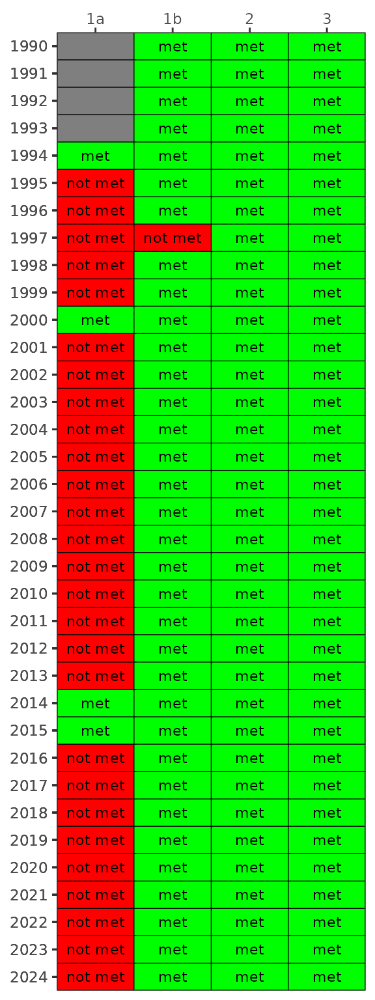

By default, the
[`show_wqmatrixpep()`](https://tbep-tech.github.io/peptools/reference/show_wqmatrixpep.md)
function returns chlorophyll exceedances by segment. Secchi depth
exceedances can be viewed by changing the `param` argument. Note that
exceedances are reversed, i.e., lower values are considered less
desirable water quality conditions for Secchi.

``` r

show_wqmatrixpep(dat, param = 'sd')
```

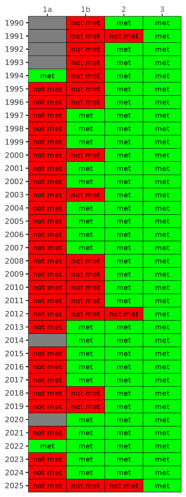

The results from
[`show_matrixpep()`](https://tbep-tech.github.io/peptools/reference/show_matrixpep.md)
for both secchi and chlorophyll can be combined for an individual
segment using the
[`show_segmatrixpep()`](https://tbep-tech.github.io/peptools/reference/show_segmatrixpep.md)
function. Only one segment can be plotted for each function call.

``` r

show_segmatrixpep(dat, bay_segment = '1a')
```

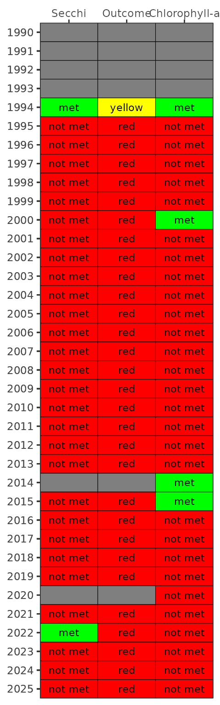

Finally, all plots for a selected segment can be shown together using
the
[`show_plotlypep()`](https://tbep-tech.github.io/peptools/reference/show_plotlypep.md)
function that combines chlorophyll and secchi data. This function
combines outputs from
[`show_thrpep()`](https://tbep-tech.github.io/peptools/reference/show_thrpep.md)
and
[`show_segmatrixpep()`](https://tbep-tech.github.io/peptools/reference/show_segmatrixpep.md).
The final plot is interactive and can be zoomed by dragging the mouse
pointer over a section of the plot. Information about each cell or value
can be seen by hovering over a location in the plot.

``` r

show_plotlypep(rawdat, bay_segment = '1a')
```

### Testing different thresholds

By default, all plotting functions use the `peptargets` data frame
included with the package, which assigns a threshold of 6.5 ft for
secchi depth and 5.5 ug/L for chlorophyll to all segments. All plotting
arguments have an optional argument called `trgs` that accepts
user-provided thresholds. A new data frame can be passed to this
argument to evaluate different thresholds. The following demonstrates
how to create a custom thresholds data frame (a tibble specifically) and
use it to evaluate changes on reporting outcomes. For examples, perhaps
less stringent thresholds are required for the 1a segment (lower secchi,
higher chlorophyll) and more stringent thresholds are required for the 3
segment (higher secchi, lower chlorophyll).

``` r

segs <- c('1a', '1b', '2', '3')
newtrgs <- data.frame( 
  bay_segment = factor(segs, levels = segs),
  name = factor(segs, levels = segs),
  sd_thresh = c(5.0, 5.5, 6.5, 7.5),
  chla_thresh = c(6.5, 6, 5.5, 5), 
  stringsAsFactors = F
)
```

This new data frame can be passed to the plotting functions.

``` r

newthr <- show_matrixpep(dat, trgs = newtrgs)
newthr
```

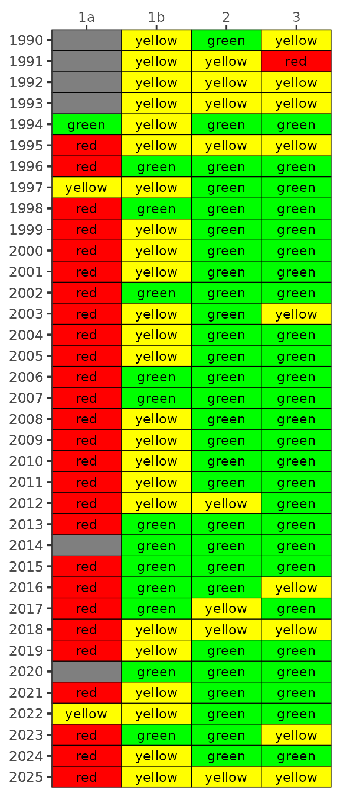

Comparing the default values with the new results can easily be done by
plotting the two side by side.

``` r

library(patchwork)

oldthr <- show_matrixpep(dat)
oldthr + newthr + plot_layout(ncol = 2)
```

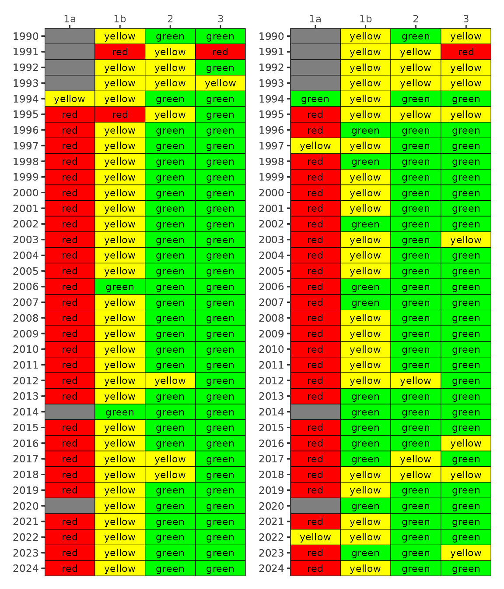

## References

\[1\]

A. Janicki, D. Wade, J.R. Pribble, Development of a process to track the
status of chlorophyll and light attenuation to support seagrass
restoration goals in Tampa Bay, Tampa Bay National Estuary Program, St.
Petersburg, Florida, 1999.
<https://tbeptech.org/TBEP_TECH_PUBS/2000/TBEP_04_00Chlor-A.pdf>.
