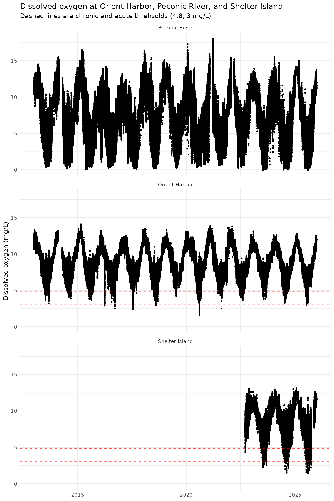
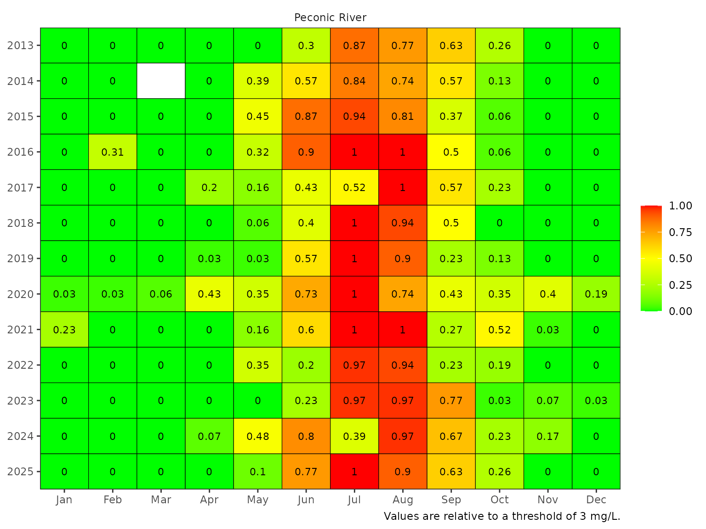
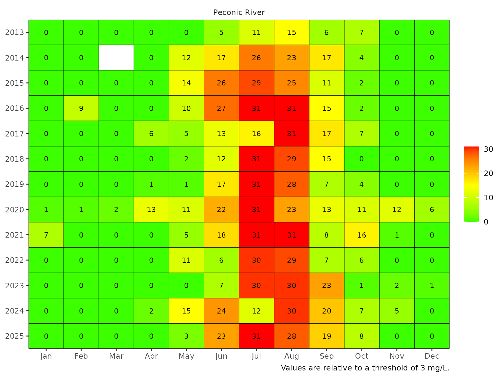
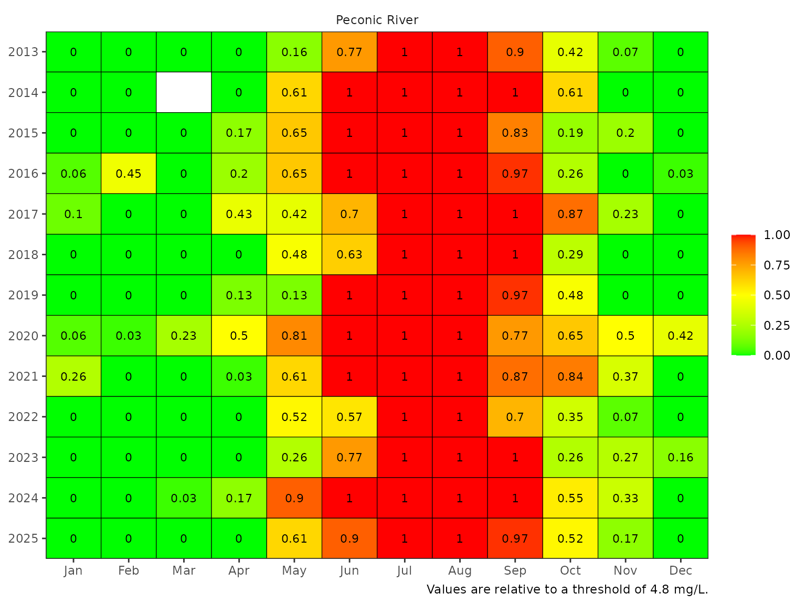

# Dissolved Oxygen

This vignette describes summarizing and reporting dissolved oxygen (DO)
data for the Peconic Estuary. Three continuous USGS monitoring stations
collect DO data at locations in the Peconic Estuary: USGS stations
01304562 in the Peconic River, 01304200 in Orient Harbor, and 01304650
in Shelter Island Sound. Data at these stations can be downloaded using
the
[`read_pepdo()`](https://tbep-tech.github.io/peptools/reference/read_pepdo.md)
function.

``` r

exdat <- read_pepdo(site = c('01304562', '01304200', '01304650'), 
                    nms = c('Peconic River', 'Orient Harbor', 'Shelter Island'), 
                    startDate = '2020-06-01', endDate = '2020-06-30')
```

The `dodat` data object included with the package provides DO data from
2013 to 2025 at the three sites. This takes several minutes to download
using the
[`read_pepdo()`](https://tbep-tech.github.io/peptools/reference/read_pepdo.md)
function, so it is included with the package for ease of use.

``` r

head(dodat)
#>            site            DateTime do_mgl
#> 1 Peconic River 2013-01-01 00:00:00   11.1
#> 2 Peconic River 2013-01-01 00:06:00   11.1
#> 3 Peconic River 2013-01-01 00:12:00   11.1
#> 4 Peconic River 2013-01-01 00:18:00   11.1
#> 5 Peconic River 2013-01-01 00:24:00   11.1
#> 6 Peconic River 2013-01-01 00:30:00   11.1
```

A plot of the raw data:

``` r

ggplot(dodat, aes(x = DateTime, y = do_mgl)) + 
  geom_point(size = 0.7) + 
  geom_hline(yintercept = 4.8, linetype = 'dashed', colour = 'red') + 
  geom_hline(yintercept = 3, linetype = 'dashed', colour = 'red') +
  facet_wrap(~site, ncol = 1) +
  theme_minimal() + 
  labs(
    y = 'Dissolved oxygen (mg/L)', 
    x = NULL, 
    title = 'Dissolved oxygen at Orient Harbor, Peconic River, and Shelter Island', 
    subtitle = 'Dashed lines are chronic and acute threhsolds (4.8, 3 mg/L)'
  )
```



Dissolved oxygen data typically show daily and seasonal variation.
Summaries of condition should account for variation at both temporal
scales. Further, the impact of low dissolved oxygen concentrations on
biota can vary depending on both magnitude and duration of
hypoxia/anoxia. As such, condition assessment should consider how often
concentrations fall below a threshold and for how long. The assessments
below speak to each of these needs.

First, the data can be summarized from the continuous (~6 minute
observations) to daily averages using the `anlz_dodlpep()` function. A
user-specified threshold can be supplied to the `thr` argument to
summarize the data relative to a value of interest, the default value
being the acute threshold of 3 mg/L (an alternative may be the chronic
threshold of 4.8 mg/L, \[1\]).

``` r

# 3 mg/l is acute, 4.8 mg/l is chronic
dlysum <- anlz_dodlypep(dodat, thr = 3)
dlysum
#> # A tibble: 10,696 × 7
#>    site          Date          yr    mo do_mgl below below_cumsum
#>    <fct>         <date>     <dbl> <dbl>  <dbl> <dbl>        <dbl>
#>  1 Peconic River 2013-01-01  2013     1   11.0     0            0
#>  2 Peconic River 2013-01-02  2013     1   11.3     0            0
#>  3 Peconic River 2013-01-03  2013     1   11.6     0            0
#>  4 Peconic River 2013-01-04  2013     1   11.6     0            0
#>  5 Peconic River 2013-01-05  2013     1   11.7     0            0
#>  6 Peconic River 2013-01-06  2013     1   11.8     0            0
#>  7 Peconic River 2013-01-07  2013     1   12.0     0            0
#>  8 Peconic River 2013-01-08  2013     1   12.1     0            0
#>  9 Peconic River 2013-01-09  2013     1   12.0     0            0
#> 10 Peconic River 2013-01-10  2013     1   11.7     0            0
#> # ℹ 10,686 more rows
```

The last three columns show the daily summarized data. The `do_mgl`
column shows the average DO concentration for each day, the `below`
column shows a 1 (yes) or 0 (no) if the concentration was below the
threshold value at any point during a day, and the `below_cumsum` column
shows a cumulative tally of the number of days in each month at which
dissolved oxygen fell below the threshold at any point during a day. By
default, the
[`anlz_dodlypep()`](https://tbep-tech.github.io/peptools/reference/anlz_dodlypep.md)
function will impute missing daily dissolved oxygen values to the
average for the year, month, site combination. This is often necessary
to create summary values that make sense. For example, if a month has
incomplete data, the maximum `below_cumsum` value will not show 30 or 31
days even if every day in the observed record is below the threshold.

The data can also be summarized by month using the
[`anlz_domopep()`](https://tbep-tech.github.io/peptools/reference/anlz_domopep.md)
function. Summarizing by month distills the information into a simple
format for plotting. Internally, the
[`anlz_domopep()`](https://tbep-tech.github.io/peptools/reference/anlz_domopep.md)
function uses the
[`anlz_dodlypep()`](https://tbep-tech.github.io/peptools/reference/anlz_dodlypep.md)
function to first summarize results by day, which are then summarized by
month.

``` r

mosum <- anlz_domopep(dodat, thr = 3)
mosum
#> # A tibble: 352 × 6
#>    site             yr mo    do_mgl below_ave below_maxrun
#>    <fct>         <dbl> <ord>  <dbl>     <dbl>        <dbl>
#>  1 Peconic River  2013 Jan    11.6      0                0
#>  2 Peconic River  2013 Feb    11.9      0                0
#>  3 Peconic River  2013 Mar    11.7      0                0
#>  4 Peconic River  2013 Apr     9.55     0                0
#>  5 Peconic River  2013 May     7.90     0                0
#>  6 Peconic River  2013 Jun     5.73     0.3              5
#>  7 Peconic River  2013 Jul     3.12     0.871           11
#>  8 Peconic River  2013 Aug     3.13     0.774           15
#>  9 Peconic River  2013 Sep     4.81     0.633            6
#> 10 Peconic River  2013 Oct     6.03     0.258            7
#> # ℹ 342 more rows
```

The last three columns show the monthly summarized data, where `do_mgl`
is the average of all daily DO averages across the month, `below_ave` is
the proportion of days in a month when concentrations in a given day
fell below the threshold (1 would mean all days had an instance of DO
below the threshold, 0 would mean none), and `below_maxrun` is the
maximum number of sequential days in a month when concentrations in a
given day fell below the threshold (30 or 31, depending on month, would
indicate all days in a month had an instance of DO below the threshold).

The `below_ave` and `below_maxrun` columns summarize the DO data
differently depending on how hypoxia/anoxia conditions can be described
relative to potential impacts on biological resources. The `below_ave`
column summarizes undersaturation relative to only the number of times
hypoxia conditions occurred, whereas the `below_maxrun` column
summarizes undersaturation relative to both the number of instances and
duration of hypoxia. In other words, biota may be stressed differently
depending on the number of times hypoxia occurs vs how long it may
persist. The two measures may indicate similar information, but not
always depending on characteristics of the DO time series.

The summarized monthly data for a station can be plotted with the
[`show_domatrix()`](https://tbep-tech.github.io/peptools/reference/show_domatrix.md)
function. In this example, the default plot shows the proportion of days
in a month when concentrations in a given day fell below a threshold of
3 mg/L for the Peconic River station.

``` r

show_domatrix(dodat, site = 'Peconic River', thr = 3, show = 'below_ave')
```



The maximum number of sequential days in a month when concentrations in
a given day fell below the threshold can also be plotted by changing the
`show` argument.

``` r

show_domatrix(dodat, site = 'Peconic River', thr = 3, show = 'below_maxrun')
```



The threshold can also be changed. For example, the chronic threshold of
4.8 mg/L shows conditions relative to a more conservative threshold.

``` r

show_domatrix(dodat, site = 'Peconic River', thr = 4.8, show = 'below_ave')
```



Plotting the results provides insights into hypoxia patterns at the site
depending on how under-saturated conditions were summarized. Additional
considerations may include:

1.  Relevance of a threshold to biological indicator
2.  Spatial extent of the indicators
3.  Breakpoints for management decisions

\[1\]

USEPA, Ambient aquatic life water quality criteria for dissolved oxygen
(saltwater): Cape cod to cape hatteras, Office of Water, Office of
Research; Development, US Environmental Protection Agency, Washington,
DC, 2000.
