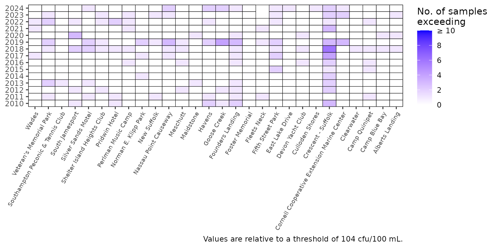

# Beach Pathogens

Regular monitoring of swimming beach pathogens is conducted by Suffolk
County Department of Health Services (SCDHS). As noted on the Suffolk
County website
(<https://www.suffolkcountyny.gov/Departments/Health-Services/Environmental-Quality/Ecology/Beach-Monitoring-Program>),
water quality at swimming beaches can be adversely affected by episodic
sources such as stormwater runoff, wastewater discharges from boats or
land-based septic systems, and fecal material from pets and wildlife. To
provide information on the potential presence of pathogens public in
swimming areas that may be impacted by such contamination, the Suffolk
County Department of Health Services (SCDHS) conducts a comprehensive
bathing beach water quality monitoring program from May through
September each year. Sampling is performed by SCDHS staff, with analyses
conducted by the Department’s accredited Public and Environmental Health
Laboratory (PEHL). Data are available
[here](https://gisportal.suffolkcountyny.gov/gis/home/item.html?id=025cb4dadb57413980dbd7e760b94da8).

Information from this monitoring program can be summarized to
communicate the relative risk of exposure to pathogens at bathing
beaches in the Peconic Estuary. Functions in the peptools package can be
used to import the pathogen data provided by SCHDS and PEHL, analyze
relative exceedances of pathogen criterion, and plot the results in an
easily interpretable format. This vignette describes use of these
functions.

For package installation instructions, please see the
[Introduction](https://tbep-tech.github.io/peptools/articles/Introduction.html)
vignette.

## Data import and processing

The `beaches` data object includes 31 beaches that are relevant for
assessing pathogen exposure risk for the Peconic Estuary Program.

``` r

beaches
#>                                                 Name FieldNum Tier
#> 1                              Alberts Landing Beach      EH7    3
#> 2                                Camp Blue Bay Beach      EH2    2
#> 3                                Camp Quinipet Beach      ST1    3
#> 4                                   Clearwater Beach      EH3    3
#> 5  Cornell Cooperative Extension Marine Center Beach      S25    3
#> 6                           Crescent Beach - Suffolk      ST3    3
#> 7                              Culloden Shores Beach      EH4    3
#> 8                             Devon Yacht Club Beach     EH39    3
#> 9                              East Lake Drive Beach     EH12    3
#> 10                           Fifth Street Park Beach      S12    2
#> 11                                 Fleets Neck Beach      S16    3
#> 12                             Foster Memorial Beach      SH9    3
#> 13                            Founders Landing Beach      S14    2
#> 14                                 Goose Creek Beach      S13    2
#> 15                                      Havens Beach      EH1    2
#> 16                                   Maidstone Beach      EH5    3
#> 17                                    Meschutt Beach      SH5    3
#> 18                       Nassau Point Causeway Beach      S15    3
#> 19                                 New Suffolk Beach      S17    3
#> 20                        Norman E. Klipp Park Beach      S11    3
#> 21                          Perlman Music Camp Beach     ST10    3
#> 22                               Pridwin Hotel Beach      ST2    3
#> 23           Shelter Island Heights Beach Club Beach      ST6    2
#> 24                          Silver Sands Motel Beach      S26    3
#> 25                             South Jamesport Beach      R14    3
#> 26     Southampton Peconic Beach & Tennis Club Beach      SH7    3
#> 27                     Veteran's Memorial Park Beach      S18    3
#> 28                                       Wades Beach      ST4    3
#>               geometry
#> 1  -72.11667, 41.00013
#> 2  -72.17883, 41.03910
#> 3  -72.37873, 41.07053
#> 4  -72.16710, 41.05097
#> 5  -72.38863, 41.03622
#> 6  -72.36563, 41.07412
#> 7  -71.94862, 41.07292
#> 8  -72.10570, 40.99253
#> 9  -71.93562, 41.07820
#> 10 -72.36612, 41.09298
#> 11 -72.46508, 41.00562
#> 12 -72.32688, 40.99640
#> 13 -72.41335, 41.06050
#> 14 -72.41348, 41.05227
#> 15 -72.28425, 41.00068
#> 16   -72.1862, 41.0344
#> 17 -72.49992, 40.89483
#> 18 -72.44713, 41.01513
#> 19 -72.47195, 40.98980
#> 20 -72.34915, 41.11078
#> 21 -72.37360, 41.07082
#> 22 -72.37558, 41.07012
#> 23 -72.35878, 41.08598
#> 24 -72.37583, 41.09417
#> 25 -72.56870, 40.94198
#> 26 -72.48165, 40.89703
#> 27 -72.53128, 40.97738
#> 28 -72.33427, 41.04942
```

The beaches can be mapped as follows:

``` r

library(leaflet)
library(sf)

leaflet(sf::st_transform(beaches, 4326)) %>% 
  addProviderTiles('Esri.WorldGrayCanvas', group = 'World Gray') %>% 
  addProviderTiles('Esri.WorldImagery', group = 'World Imagery') %>% 
  addProviderTiles('Esri.WorldTopoMap', group = 'World Topo Map') %>% 
  addLayersControl(baseGroups = c('World Gray', 'World Imagery', 'World Topo Map')) %>% 
  addCircleMarkers(radius = 6, color = 'black', weight = 1, fillColor = 'tomato', fillOpacity = 0.8, label = ~Name)
```

The pathogen data for these beaches can be imported using the
[`read_pepent()`](https://tbep-tech.github.io/peptools/reference/read_pepent.md)
function. This function retrieves data directly from an ArcGIS REST
service available at
<https://gis.suffolkcountyny.gov/hosted/rest/services/Hosted/Beach_Water_Quality_Data/FeatureServer/>.
The API is queried by beach names in the `beaches` data object. The
queries are done individually for each beach to not exceed the 2000
record limit. A spreadhseet including the same data can also be
downloaded from
[here](https://gisportal.suffolkcountyny.gov/gis/home/item.html?id=025cb4dadb57413980dbd7e760b94da8).

The import function is used as follows:

``` r

entdat <- read_pepent()
head(entdat)
```

    #>                    Name FieldNum       Date value status
    #> 1 Alberts Landing Beach      EH7 2010-06-29     4      =
    #> 2 Alberts Landing Beach      EH7 2010-07-27     4      =
    #> 3 Alberts Landing Beach      EH7 2010-08-13    28      =
    #> 4 Alberts Landing Beach      EH7 2011-06-22     4      =
    #> 5 Alberts Landing Beach      EH7 2011-07-20     4      =
    #> 6 Alberts Landing Beach      EH7 2011-08-17     4      =

The data can also be imported from a local file using the `path`
argument.

``` r

entdat <- read_pepent(path = '~/Desktop/pathogen_data.xlsx')
```

The raw data includes concentrations of *Enterococcus* bacteria as
cfu/100 mL for swimming beaches in Suffolk County. The fields include
beach name (`Name`), field number (`FieldNum`), collection date and time
(`Date` as Eastern Standard Time), bacteria concentration (`value`), and
`status` showing if the observation was above or below detection
(indicated as `>` or `<`).

The function
[`anlz_entpep()`](https://tbep-tech.github.io/peptools/reference/anlz_entpep.md)
summarizes the imported data at each beach to quantify instances when
bacterial concentrations were at risk of impacting human health. For
Suffolk County, all bathing beaches are ranked by relative risk of
exposure to harmful bacteria. Factors considered in the ranking include
pollution threats (outfalls, discharges, runoff, marinas, etc.), beach
location, historical monitoring data, and beach use. Most beaches in the
Peconic Estuary are Tier 3 (lowest tier). For the peptools package, the
*Enterococcus* data were used to count the number of instances at each
beach when concentrations were above 104 cfu/ml. Although this does not
mean a beach was closed, relative exceedances provide a coarse measure
of potential risk of exposure to harmful pathogens.

The
[`anlz_entpep()`](https://tbep-tech.github.io/peptools/reference/anlz_entpep.md)
function estimates this exposure risk by counting the number of
instances in a year when concentrations at a beach exceeded the
threshold for each 24 hour period in the dataset. The results show
`samples` for number of days sampled each year and number of
`exceedances` for the samples. Only the 28 relevant beaches for the
Peconic Estuary are returned.

``` r

anlz_entpep(entdat)
#> # A tibble: 418 × 4
#>    Name               yr samples exceedances
#>    <chr>           <dbl>   <int>       <int>
#>  1 Alberts Landing  2010       3           0
#>  2 Alberts Landing  2011       3           0
#>  3 Alberts Landing  2012       4           0
#>  4 Alberts Landing  2013       3           0
#>  5 Alberts Landing  2014       4           0
#>  6 Alberts Landing  2015       3           0
#>  7 Alberts Landing  2016       5           0
#>  8 Alberts Landing  2017       3           0
#>  9 Alberts Landing  2018       6           1
#> 10 Alberts Landing  2019       3           0
#> # ℹ 408 more rows
```

The
[`anlz_entpep()`](https://tbep-tech.github.io/peptools/reference/anlz_entpep.md)
function includes an optional arguments for the threshold (`thr`). The
default values are 104 cfu/100 mL, which can easily be changed. Here we
use a threshold of 50 cfu/100 mL.

``` r

anlz_entpep(entdat, thr = 50)
#> # A tibble: 418 × 4
#>    Name               yr samples exceedances
#>    <chr>           <dbl>   <int>       <int>
#>  1 Alberts Landing  2010       3           0
#>  2 Alberts Landing  2011       3           0
#>  3 Alberts Landing  2012       4           0
#>  4 Alberts Landing  2013       3           0
#>  5 Alberts Landing  2014       4           0
#>  6 Alberts Landing  2015       3           0
#>  7 Alberts Landing  2016       5           0
#>  8 Alberts Landing  2017       3           0
#>  9 Alberts Landing  2018       6           1
#> 10 Alberts Landing  2019       3           0
#> # ℹ 408 more rows
```

## Plotting results

A summary graphic can be plotted using the
[`show_entmatrix()`](https://tbep-tech.github.io/peptools/reference/show_entmatrix.md)
function. This creates an annual reporting matrix for the relative risk
of pathogen exposure at 28 selected beaches in the Peconic Estuary.
Tracking the number of exceedances of bacterial concentrations provides
a framework for identifying locations that may need management actions
to remediate potential public health issues.

``` r

show_entmatrix(entdat)
```


Exceedances of *Enterococcus* concentrations at Peconic Estuary bathing
beaches for the years 2010 through 2024. Values are number of samples
exceeding.

The
[`anlz_entpep()`](https://tbep-tech.github.io/peptools/reference/anlz_entpep.md)
function is used internally in
[`show_entmatrix()`](https://tbep-tech.github.io/peptools/reference/show_entmatrix.md),
such that the optional argument for the threshold (`thr`) also applies
in the plotting function. Appropriate thresholds should be identified.
Potential alternatives can be viewed by using a different value for the
`thr` argument.

``` r

show_entmatrix(entdat, thr = 35)
```


Exceedances of *Enterococcus* concentrations at Peconic Estuary bathing
beaches for the years 2010 through 2024. A different option is used for
the threshold argument.

The matrix is also a `ggplot` object and its layout can be changed using
`ggplot` elements. Note the use of `txtsz = NULL` to remove the text
labels.

``` r

show_entmatrix(entdat, txtsz = NULL) +
  scale_x_discrete(expand = c(0,0), breaks = c(2000:2024)) + 
  coord_flip() +
  theme(axis.text.x = element_text(angle = 60, hjust = 1, size = 7))
```


